# DawaiSathi

DawaiSathi is a family-focused medicine and checkup tracker with an age-inclusive interface. It helps people record doses, manage medicine schedules, organize prescriptions, and coordinate care across family groups.

The app has four main tabs: **Today, Care, History, and Settings**. It uses a React Native/Expo frontend, a FastAPI backend, and MongoDB.

## Live staging — try the app

**[Open DawaiSathi](https://dawaisathi-staging-34-100-169-52.sslip.io)** — the shared browser testing environment.

- Sign in with your **staging account**. New testers currently need a family invitation from the family owner; independent public signup is not enabled. Local accounts are not automatically copied to staging.
- Use synthetic test data only, not real medical records. This is a testing environment, not a production medical or notification service.
- The app runs on a dedicated Google Cloud server in Mumbai using Docker Compose: a web frontend, FastAPI backend, MongoDB and Caddy HTTPS proxy. It stays online when the developer's laptop or local Docker is turned off; cloud running costs continue.
- Staging has its own database, uploads and secrets, separate from local development. Only web ports 80/443 are public; the database and API containers are private, and server administration uses Google's IAP tunnel.
- HTTPS, deep links, database readiness and anonymous-access rejection were verified during deployment. On 12 October 2026, the web, API and database containers were confirmed healthy. Full authenticated workflow testing and backup/restore verification remain pending.
- The temporary `sslip.io` hostname uses third-party DNS. An Android APK is deferred; testers can use the browser link now. Reminder delivery integrations remain subject to the limitations below.

Developers: see the [Docker setup guide](docs/DEVELOPER_SETUP.md). Deployment details: [staging handoff](docs/STAGING.md), [GCP deployment record](deploy/gcp/README.md) and [verification results](docs/DOCKER_VERIFICATION.md).

## Screenshots

These are actual local web-app captures, not design mockups. Every screenshot uses a **410 × 900 portrait phone viewport**. Dates and counts reflect the local data at capture time, not live information. Today, Inbox and the shared add menu/form were captured again on 10 October 2026.

| Today — earlier overview | Today — taken-dose view |
| --- | --- |
| 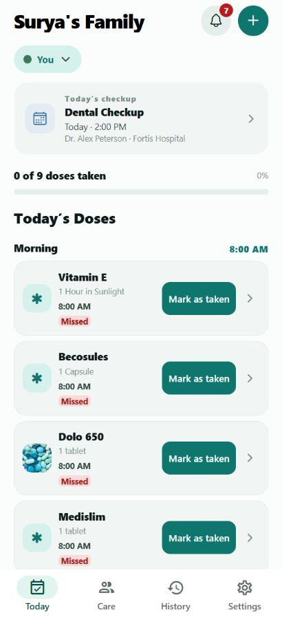 | 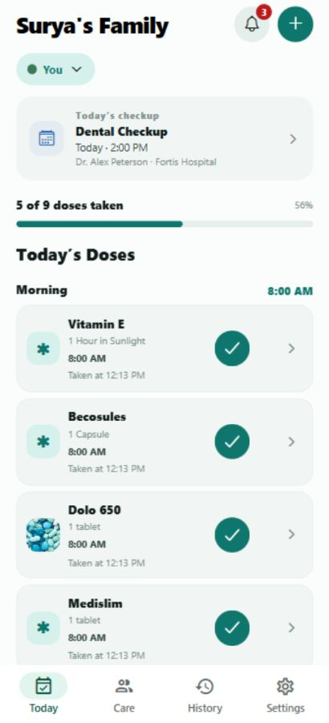 |

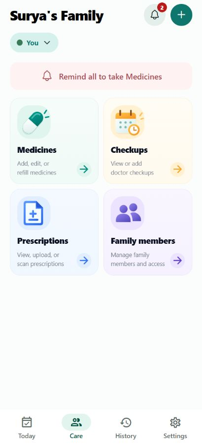

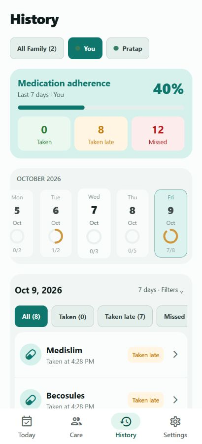

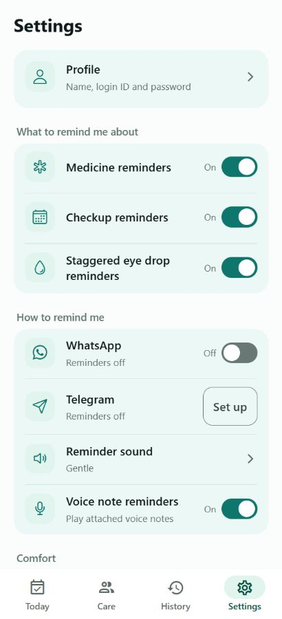

**[View the full 30-screenshot gallery](docs/screenshots/README.md)** — Today, dose details, member selection, Inbox, add flows, eye-drop protocols, medicines, checkups, prescriptions, family management, History, Settings, and password editing.

Capture limitations: loading, expired-session and unfinished sheet-transition captures are not included. Family create/join/invitations/recovery and the add-prescription sheet still have coverage gaps. Profile account identifiers, invitation tokens/QR codes, passwords, and readable prescription pages are deliberately not shown. These are phone-sized web views, not captures from a physical phone or proof of native-device integration behavior.

## Contents

- [Live staging — try the app](#live-staging--try-the-app)
- [App walkthrough](#app-walkthrough)
- [Tracking rules](#tracking-rules)
- [Implementation and integration status](#implementation-and-integration-status)
- [Architecture and repository map](#architecture-and-repository-map)
- [Run locally](#run-locally)
- [Accounts and family access](#accounts-and-family-access)
- [Testing](#testing)
- [Team collaboration](#team-collaboration)
- [Security, data and safety](#security-data-and-safety)
- [Troubleshooting](#troubleshooting)

## App walkthrough

### Today

Today is the daily action screen. The family-group selector changes the household context; the member selector changes whose records are visible within that group. These are separate controls.

**Reading the Today screen:** the family name, Inbox bell and global **+** remain at the top. The **You** chip opens the person selector without switching households. A today-only checkup card shows the visit reason, doctor, location and time. Beneath it, the count and percentage summarize today's doses, followed by the time-grouped medicine list.

Each dose card shows a medicine name/photo, dosage, scheduled time and a text status. **Missed** stays visible in red while the user can still record the dose; **Late**, **Ready** and **Upcoming** distinguish other timing states. Future locked doses have no Mark as taken action yet. The right-side chevron opens details independently of the recording button.

- A progress bar shows the taken count, for example `3 of 9 doses taken`, with a separate percentage.
- Doses are grouped into Morning, Afternoon, Evening and Night.
- An available untaken dose has a teal **Mark as taken** button. A taken dose shows a check circle and its actual taken time.
- Tapping the check circle undoes the record. Marking/undoing updates the UI optimistically, without replacing the list with a full-page loading screen; failed writes can roll back the affected action.
- The chevron opens dose details, including schedule, dosage, stock/identification information and recent logs. Editing uses the shared medicine form.
- Checkups appear here only when their local calendar date is today, including appointments whose time has already passed. Opening the checkup area leads to Checkups.
- The Inbox opens as a sheet, and the global **+** opens the shared action menu.

The progress bar animates after dose changes; the taken-count text does not. The taken check uses a transition animation, and supported devices receive haptic feedback according to the user's setting.

**Further down the timeline:** staggered eye drops have a separate protocol card showing its start/end time, interval, step count, current step and status. Afternoon and Night sections keep later doses visible. The docked four-tab bar provides navigation while the list scrolls.

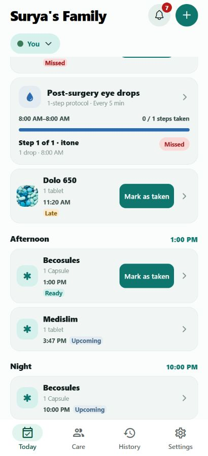

**Dose details:** opening a chevron shows dosage, schedule, identification cue, stock and recent dose logs, plus edit/delete controls. Detailed logs may retain taken/undo audit times even though undone entries are hidden from the History tab.

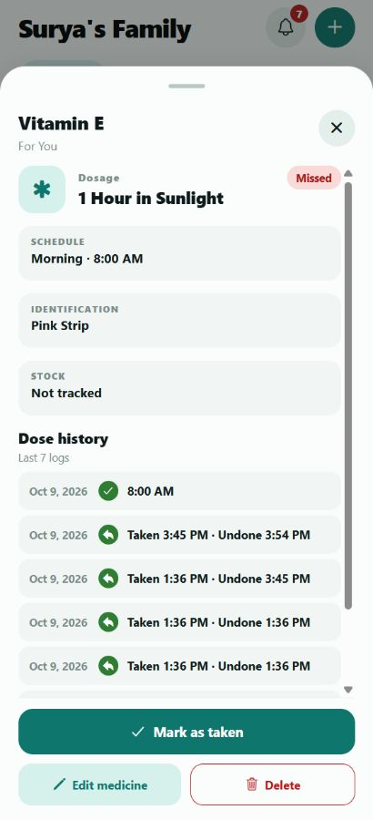

**Member selection:** choose a person to view their care records. The sheet also exposes member management and invitation entry points. No doses were marked taken, undone, or deleted to create these screenshots. The earlier Today overview shows untaken doses; the newer parallel capture shows five of nine doses taken, with check circles and actual taken times.

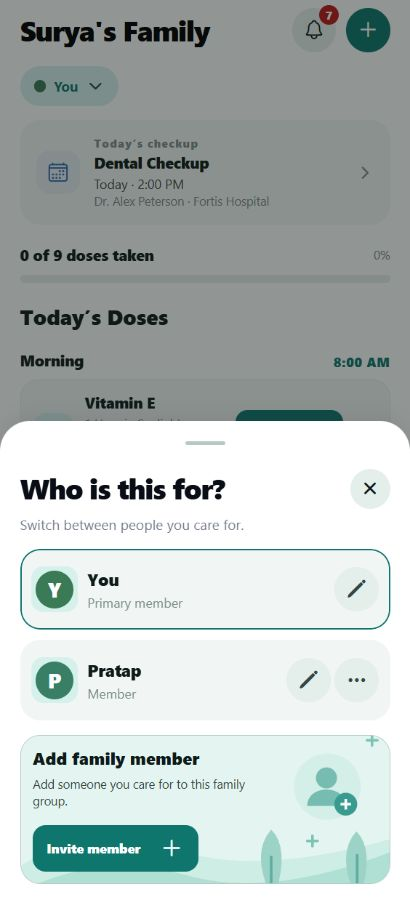

### Global add menu

The sheet is titled **What would you like to do?** and offers:

1. **Add medicine** — name, dosage, recipient, daily/weekly/as-needed frequency, days and reminder times, with additional medicine information.
2. **Staggered eye drops** — a separate ordered protocol rather than an ordinary medicine schedule.
3. **Scan prescription** — capture a prescription with a supported device camera.
4. **Upload prescription** — select an image or PDF.
5. **Add checkup** — use the same checkup form as the Care section.

Medicine editing and prescription-related medicine entry reuse the main medicine form rather than a second incompatible editor. Forms support optional attached voice notes where offered; recording requires microphone permission.

### Inbox

The Inbox sheet has a sliding **All / Missed** selector. All contains the available reminder/alert records and pending reminder requests; Missed focuses on missed-dose and missed-protocol-step alerts. Relevant actionable alerts offer **Send reminder again**.

Resend requests are family-scoped and persisted with duplicate-request protection. A saved request is **pending**, not proof that a push, WhatsApp message or Telegram message reached anyone. Older/stale alerts may not offer resend.

### Care

Care provides four entry points: **Medicines, Checkups, Prescriptions, and Family members**. The light-red **Remind all to take Medicines** button has press feedback, a bell animation and a temporary success check state. It prevents repeat taps while ringing/showing success.

**Important:** this family reminder is currently a UI preview. Its “Reminder sent” state does not represent real delivery.

### Medicines

The medicine cabinet supports adding/editing medicines, schedules, member/shared assignment, identification details, photos, stock quantities and refills. Medicine photos can be selected on web or a device. Backend validation accepts JPEG, PNG and WebP up to **5 MB**.

Stock tracking is optional. Dose recording and undo have corresponding stock-handling logic; team testing should include low-stock, refill and repeated-undo cases. Archived/inactive medicines are distinct from active scheduled medicines.

### Staggered eye-drop protocols

A protocol has its own name, recipient, start time(s), interval and ordered steps. Each step can specify the medicine, amount and left/right/both eyes. The editor supports adding/reordering/removing steps. Today shows protocol progress separately from ordinary dose cards, and History can include protocol-step records.

The protocol follows the order and timing entered by the user. It does not determine whether a treatment, interval or combination is medically appropriate.

### Checkups

“Checkups” is the user-facing name for doctor visits and appointments throughout the current flow.

- **Next checkup** highlights the nearest future date/time.
- Other upcoming visits appear as compact cards; notes remain in details.
- The form collects reason, doctor, family member, date, time, location and optional notes.
- Details provide edit and delete actions, with confirmation before deletion.
- **Past checkups** lists scheduled visits whose time has passed. This classification does not certify that the visit was attended.
- A past visit can be copied through **Add as new checkup**, allowing follow-up scheduling without editing the original.

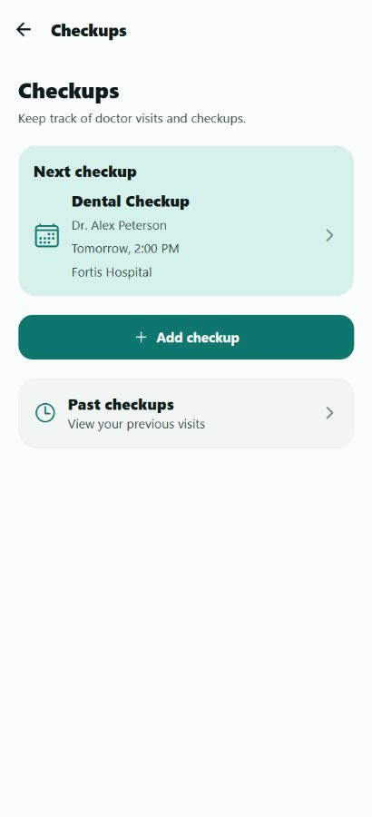

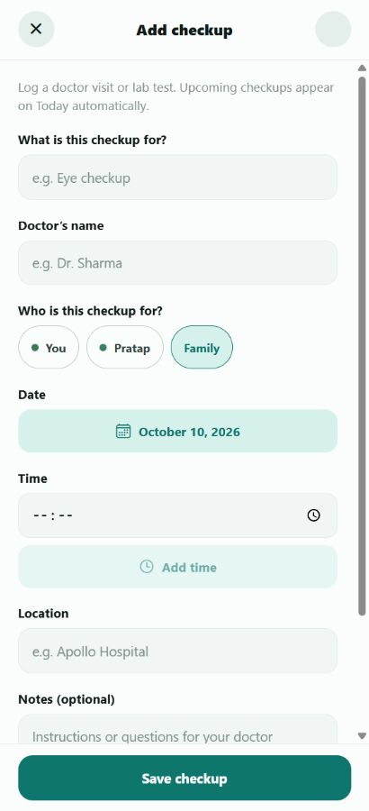

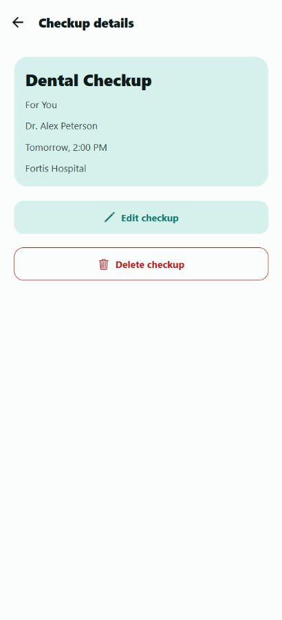

### Prescriptions

Prescriptions stores documents and manually reviewed information. Users can start with camera capture, image/PDF upload or manual entry, review pages, add/edit medicine information, and manage saved prescriptions.

- The review flow includes prescription date and doctor/clinic details.
- The current review form omits the redundant recipient and notes block previously present there; the record still has family/member context.
- Medicine entry opens the shared add/edit medicine screen.
- Saving a prescription does **not** automatically add its medicines to the active cabinet.
- Details offer document/medicine review and management actions, including archive and confirmed deletion, with download/share support depending on platform.
- Supported uploads: JPEG, PNG, WebP and unlocked PDF, **10 MB per file**, up to **20 uploaded items** per prescription. A PDF must have **1–50 pages**.
- The backend validates content and generates previews. It does **not** perform OCR or automatically detect medication instructions.

Camera capture, recording, downloads and native sharing need device/platform testing. Browser screenshots do not establish that these native features work.

### Family management

Family management reuses the Home family-group create/join/invite mechanisms rather than introducing a separate membership system.

- The current family card displays its name, member count and owner. The stacked cards expand on interaction and retain each family's color when switching.
- **Create a family** starts a separate group; **Join a family** accepts a shared code/invitation, with QR scanning on supported devices.
- **Family members** lists profiles and provides invite/add-member actions. Profiles can have relationship information and optional account-invite details.
- The two care roles are **Member** and **Caretaker**. Family ownership is a separate authorization property, not a third selectable care role.
- **Invitations** supports invite management, including expiring, single-use invitation tokens and cancellation. Email-bound invitations require the matching signed-in email. Do not assume every legacy family join code has the same lifecycle as a single-use invitation token.
- **Recently deleted** provides recovery for eligible deleted records. Family recovery is limited to **30 days**.
- Family/member deletion uses confirmation. Leaving a family removes access; owners are prevented from leaving without resolving ownership.

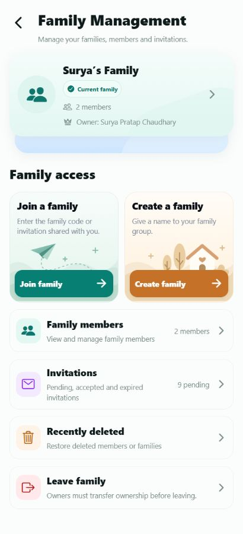

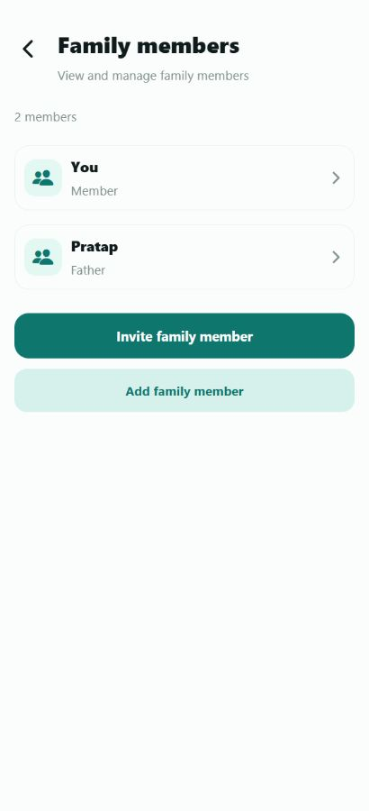

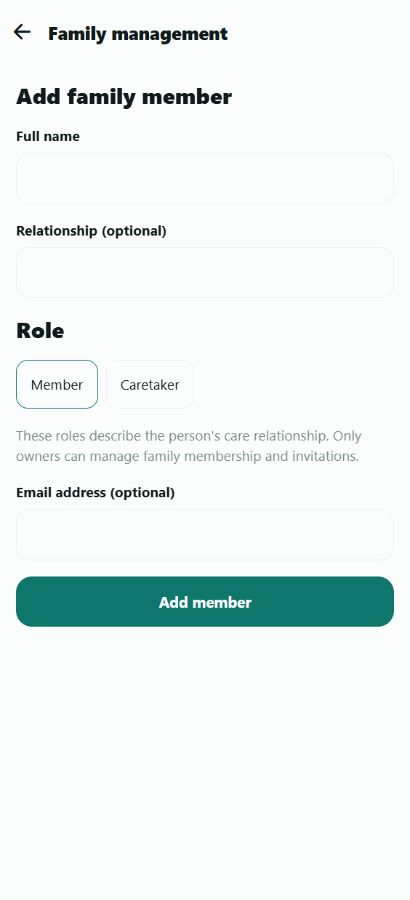

### History

History combines a family/member filter, medication-adherence summary, horizontal date cards and a compact event list.

- Summary tiles distinguish **Taken**, **Taken late** (yellow) and **Missed** (red). There is no Skipped category.
- Range/medicine filters and a selected day control which records are displayed.
- The collapsed medicine row shows the name, status and actual taken time where available.
- Expanding its chevron reveals schedule, shared/member context and remaining details on the same white background.
- Undo audit entries are retained by the recording workflow but hidden from the History list.
- Adherence is the proportion of **recorded taken events to recorded taken plus missed events**, including late doses as taken. It is not a clinical outcome score or proof that every historical scheduled dose was reconstructed.

### Settings and Profile

Settings uses grouped, lightly teal-tinted cards, large rows, existing icons and explicit **On/Off** text beside switches. Changes apply immediately without a Save Settings button.

| Section | Controls |
| --- | --- |
| Profile | Name, login ID and password |
| What to remind me about | Medicine, checkup and staggered eye-drop reminder switches |
| How to remind me | WhatsApp preference, Telegram setup entry, reminder sound, voice-note reminders |
| Comfort | Normal/Large/Extra large text and Haptic feedback |
| Log out | Neutral button and confirmation |

Turning medicine reminders off shows a warning note. The voice-note toggle controls attached voice notes from medicine/checkup/protocol forms; Settings does not provide a separate global voice recorder. Reminder sounds include **Gentle, Chime, Bell and Soft** with preview controls.

Profile supports name/login-ID changes and a password form with current/new/confirm fields, Show control and an eight-character minimum. Login-ID confirmation explains which ID to use next time. Back navigation has a Settings fallback when no earlier route exists.

WhatsApp/Telegram controls and sound preferences should not be interpreted as completed messaging or operating-system notification integrations.

## Tracking rules

The following describes current code behavior, not dosing advice:

| Situation | Current classification |
| --- | --- |
| Untaken, more than 60 minutes before schedule | Upcoming/locked |
| Untaken, within 60 minutes before to under 15 minutes after | Ready |
| Untaken, 15 minutes to under 180 minutes after | Late |
| Untaken, 180 minutes or more after | Missed |
| Taken up to 30 minutes after schedule | Taken |
| Taken more than 30 and up to 180 minutes after | Taken late |
| Taken more than 180 minutes after | Taken very late internally; grouped with late in History |

Today deliberately uses **calendar-date** comparison for checkups; Upcoming/Past use **exact timestamps**. Consequently, a checkup earlier today can appear both on Today and in Past checkups. Next checkup is the earliest valid timestamp at or after now.

Checkup display uses the client's local time. Some backend dose-date logic uses the server's local date; deployment timezone consistency and midnight/timezone-boundary tests are still necessary.

## Implementation and integration status

| Area | Current boundary |
| --- | --- |
| Dose tracking, medicine/checkup/family management | Implemented app/API workflows; verify individual changes with tests and real UI |
| Prescription storage and manual review | Implemented; no OCR or automatic medicine creation |
| Inbox reminder resend | Persists pending, idempotent requests; no delivery worker connected |
| Care “Reminder sent” animation | UI preview only; no notifications sent |
| WhatsApp and Telegram reminders | Not connected to actual senders/bot delivery |
| Background/local OS notifications | Not established by the current frontend dependencies/workflows; scheduling integration remains |
| Voice notes | Attachment/record/play workflows; not a verified custom notification-sound integration |
| Haptics | Central expo-haptics helpers; disabled on web and when preference is off |
| Google sign-in | Implementation/configuration guide present; requires project credentials and native-build setup |
| Docker | Full-app developer and separate staging Compose stacks supplied; clean-container tests and local persistence rehearsal completed |

## Architecture and repository map

```text
Expo Router app (web / Android / iOS)
  ├── Today / Care / History / Settings
  ├── Shared forms, sheets, PressableScale and haptics
  └── API client + session/data contexts
                 │ authenticated HTTP /api
                 ▼
FastAPI backend
  ├── Authentication, doses, medicines, checkups and protocols
  ├── Family-management and prescription routers
  ├── MongoDB: accounts, groups, records, preferences and requests
  └── Local files: medicine images, prescription files and voice notes
```

Key dependencies currently declared: Expo **57.0.24**, React **19.2.3**, React Native **0.86.3**, TypeScript **6.0.3**, TanStack Query, Expo Router, SecureStore/AsyncStorage, Expo camera/audio/haptics, FastAPI **0.110.1**, Uvicorn **0.25.0**, Motor **3.3.1**, PyMongo **4.6.3**, JWT/bcrypt and PyMuPDF. The package lockfiles/requirements are the source of truth for installation.

```text
frontend/
  app/(tabs)/              Main four screens and tab layout
  app/care/                Medicines, checkups, prescriptions, families
  app/settings/            Profile and settings navigation
  app/add-*.tsx            Shared medicine/checkup/protocol forms
  src/api.ts               API URL, auth headers and error handling
  src/auth-context.tsx     Session lifecycle
  src/data-context.tsx     App data and optimistic mutations
  src/checkup-schedule.ts  Today/upcoming/past classification
  src/dose-status.ts       Dose timing/status rules
  src/components/          Reusable UI, sheets, tab bar and voice notes
  src/utils/               Storage, haptics and text-size preferences
  scripts/*.test.cjs       Frontend regression tests
backend/
  server.py                FastAPI app and core endpoints
  family_management.py     Membership and invitation routes
  prescriptions.py         Prescription validation, files and routes
  tests/                   Backend tests
  data/                    Local uploaded files (ignored by Git)
docs/screenshots/          Actual UI captures and full gallery
GOOGLE_SIGN_IN_SETUP.md    OAuth/native Google sign-in setup
Start-DawaiSathi-Web.*     Windows development launcher
Stop-DawaiSathi-Web.*      Stop launcher-owned processes
```

## Run locally

**Team setup:** use the [Docker developer guide](docs/DEVELOPER_SETUP.md) for a
separate containerized frontend, backend and database. See
[staging and Android handoff](docs/STAGING.md) for deployment/distribution.
The host-based instructions below remain an alternative for the existing setup.

These commands describe a Windows/PowerShell development setup. Prerequisites are Git, Node.js with Yarn Classic (the project declares Yarn **1.22.22**), Python with venv/pip, and MongoDB. Docker Desktop is an option for MongoDB. A completely fresh dependency installation was not performed for this documentation update.

### 1. Clone and prepare MongoDB

```powershell
git clone https://github.com/chaudharysuryapratap/DawaiSathi.git
cd DawaiSathi
```

For a **new** local MongoDB container only:

```powershell
docker run --name dawaisathi-mongo -p 127.0.0.1:27017:27017 -v dawaisathi-mongo-data:/data/db -d mongo:7
```

If that named container already exists, use `docker start dawaisathi-mongo` instead. The volume retains data across container restarts. Do not delete it to troubleshoot an ordinary startup issue.

### 2. Backend environment

Create `backend/.env` locally with these settings. Replace the placeholders with independently generated random secrets; **do not commit this file**.

```dotenv
MONGO_URL=mongodb://127.0.0.1:27017
DB_NAME=dawaisathi_dev
DAWAISATHI_AUTH_SECRET=REPLACE_WITH_A_RANDOM_SECRET_AT_LEAST_32_CHARACTERS
DAWAISATHI_BOOTSTRAP_TOKEN=REPLACE_WITH_A_RANDOM_TOKEN_AT_LEAST_20_CHARACTERS
CORS_ORIGINS=http://localhost:8081,http://127.0.0.1:8081
# Optional, for configured Google sign-in:
# GOOGLE_WEB_CLIENT_ID=your-web-oauth-client-id
```

Install and run from the repository root:

```powershell
py -m venv backend\.venv
.\backend\.venv\Scripts\python.exe -m pip install -r backend\requirements.txt
.\backend\.venv\Scripts\python.exe -m uvicorn server:app --app-dir backend --host 127.0.0.1 --port 8000 --reload
```

API documentation is at `http://127.0.0.1:8000/docs`. The API prefix is `/api`.

### 3. Frontend

In a second terminal:

```powershell
cd frontend
yarn install --frozen-lockfile
npx expo start --web --port 8081
```

Open `http://localhost:8081`. The default browser backend is `http://127.0.0.1:8000`. To override it, set `EXPO_PUBLIC_BACKEND_URL_WEB` in `frontend/.env` and restart Expo.

Frontend backend-URL values must be the **origin without `/api`**, because the client appends that prefix. Client environment values are public bundle configuration: never put backend secrets in them.

### 4. Windows launcher after first-time setup

Run `Start-DawaiSathi-Web.bat` from the root. It expects the existing Mongo container, installed frontend dependencies, backend venv and configured backend secrets. It starts missing development services and writes logs under `%LOCALAPPDATA%\DawaiSathi\logs`. It can use an alternate web port when an existing LAN Expo server occupies 8081.

`Stop-DawaiSathi-Web.bat` stops only processes recorded as launched by this helper. It does not stop MongoDB or unrelated/pre-existing development servers.

### Android / iOS development

For a physical device, configure `EXPO_PUBLIC_BACKEND_URL` to the computer's LAN-reachable backend origin, not `localhost`/`127.0.0.1`. Run the backend on an appropriate trusted-network interface and allow only necessary firewall access. Do not expose MongoDB publicly.

Use the project's Expo scripts/development build as appropriate for the platform. Native Google sign-in requires configuration and a development build rather than Expo Go; follow [GOOGLE_SIGN_IN_SETUP.md](GOOGLE_SIGN_IN_SETUP.md). Native camera, audio, haptics and sharing must be tested separately from the browser UI.

## Accounts and family access

The first owner registration requires the configured bootstrap token. It is not an unrestricted public-signup system. Later new accounts use valid invitations, and existing accounts can join authorized families through the join flow.

Email/password authentication uses a 24-hour bearer session. Native token storage uses SecureStore; browser sessions use localStorage. Group membership is checked by the backend for protected family data. Google sign-in needs matching frontend/backend OAuth configuration; matching an existing email is not a reason to silently link accounts without authentication.

Provide team members their **own accounts/invitations**, not your personal password or bootstrap token. Share configuration secrets only through a private channel or secret manager.

## Testing

Docker verification on 10 October 2026: **105 frontend tests passed**, **TypeScript checking passed**, and **13 selected backend tests passed** inside clean containers with an isolated MongoDB. Developer and local staging stacks passed HTTP/deep-link/authentication checks; synthetic database/upload markers survived container recreation. This supersedes the earlier host run that could not reach MongoDB. See the [verification record](docs/DOCKER_VERIFICATION.md). Public HTTPS staging was subsequently deployed and checked; full authenticated staging workflows, a fresh teammate machine, physical-device behavior and notification delivery remain unverified.

Frontend regression tests and type checking:

```powershell
cd frontend
node --test scripts/*.test.cjs
npx tsc --noEmit
```

The frontend suite includes storage/auth, date classification, optimistic dose actions, tab animations/haptics, family flows, Settings/Profile, prescriptions, typography and voice-note behavior. Many are isolated or source/component-level tests, not full physical-device tests.

Selected backend tests use a fixture that creates uniquely named `dawaisathi_test_*` databases and removes only those temporary databases after each test. With MongoDB running, from `backend`:

```powershell
.\.venv\Scripts\python.exe -m pytest tests/test_family_auth_isolated.py tests/test_profile_settings.py tests/test_inbox.py tests/test_google_auth_isolated.py tests/test_persistence_isolated.py -q
```

Do not blindly run every legacy integration test against a database containing personal records. Inspect fixture/setup behavior and use a disposable test environment for broader CRUD/file tests.

### Suggested manual test pass

- Sign in, reload, restore the session, sign out, and verify Profile back navigation from a direct URL.
- Mark a dose taken, undo it, repeat with a delayed/failing network, and confirm no full-page loading flash or duplicate stock deduction.
- Check today/past/future visits across midnight and timezone offsets.
- Create/edit a medicine and a multi-step eye-drop protocol; test attached voice notes with microphone permission denied and allowed.
- Add/edit/delete a disposable checkup; copy a past visit as new.
- Upload an image/PDF prescription, review it, and verify that saving alone does not create active medicines.
- Switch families, verify member/group separation, test invitation expiry/reuse, and attempt unauthorized cross-family API access.
- Check History's late/missed filters, hidden undo entries and expanded details.
- Check large/extra-large system/app text, Reduce Motion, bottom safe areas, button hit areas and haptics-off behavior on devices.
- Verify the distinction between a pending reminder request, the Care preview state and real notification delivery before enabling any sender.

## Team collaboration

The repository provides the source, not your local database, uploads, environment files, dependencies or virtual environment. Each developer should clone it, install dependencies, create their own `.env` files and use a separate development database.

1. Give developers repository access and have them work on separate branches with pull requests. Keep secrets and personal records out of commits/screenshots.
2. For non-technical testers, provide a dedicated staging deployment or configured device build with test accounts and disposable data. An Expo development server on your laptop is not an always-on team testing service.
3. Keep a shared test checklist and record device/OS, reproduction steps, expected/actual behavior and a screenshot for each bug.
4. Before distributing a shared environment, configure HTTPS, explicit CORS origins, protected storage, backups, secret management and integration delivery status.

The repository now includes a [full Docker developer setup](docs/DEVELOPER_SETUP.md)
and a [separate staging configuration](docs/STAGING.md). The existing Windows
services and Mongo container remain independent. Approved GCP staging is now at
[DawaiSathi Staging](https://dawaisathi-staging-34-100-169-52.sslip.io), using separate
storage initialized separately from local data and an approved temporary third-party hostname. HTTPS, entry/deep
links, readiness and anonymous-access rejection were verified. Owner registration,
authenticated QA, Android APK and backup restore are still pending. Use synthetic
data only. See the [deployment record](deploy/gcp/README.md) and
[verification record](docs/DOCKER_VERIFICATION.md) for observed results.

## Security, data and safety

- Do not commit `.env`, tokens, invitation QR codes, credentials, database dumps or real medical documents.
- MongoDB holds app records; uploaded medicine photos, prescriptions and voice notes live under backend local media directories. Back up both records and files when retention matters.
- Browser localStorage tokens are readable by same-origin JavaScript and are not equivalent to HttpOnly sessions. Evaluate stronger browser-session isolation before production deployment.
- Keep uploaded health documents on trusted infrastructure with access controls. Local storage and authentication alone do not establish regulatory compliance.
- Haptics use central `expo-haptics` helpers, respect the preference and return immediately on web. Text scaling and Reduce Motion support still require real-device accessibility checks.
- DawaiSathi records user-entered schedules and actions. It does not diagnose, prescribe, recommend a medicine, validate a dosage or certify treatment adherence. A missed-dose label is not an instruction to take an extra dose.

## Troubleshooting

| Symptom | Check |
| --- | --- |
| `{"detail":"Bad Request"}` | A request was rejected. Inspect its URL, HTTP status, payload and corresponding backend log; the text alone does not identify the cause. Do not paste tokens into a bug report. |
| Sign-in/session expired | Sign in again; confirm backend secret consistency and device clock. Do not assume every network error is an expired token. |
| Loading/network error on web | Confirm backend and MongoDB are running, correct backend origin, and matching CORS origin/port. |
| Device cannot reach backend/Expo | Confirm trusted LAN reachability and configured computer IP; device localhost points to the device itself. |
| Icons appear as squares on web | Wait for icon fonts and inspect font/network loading before capturing the screen. |
| “Reminder sent” but no notification | Care is currently a success preview; Inbox requests remain pending until delivery integration exists. |
| Uploaded prescription has no detected medicines | OCR is not implemented; enter/review medicines manually. |
| Different today/past dates across devices | Inspect timezone and actual stored timestamps; distinguish calendar date from exact-time classification. |

Documentation prepared from the current local source and UI captures on **9–10 October 2026**. See the screenshot gallery for capture coverage and exclusions.
