# DawaiSathi screenshot gallery

30 actual local web-app screenshots captured on 9–10 October 2026. **All use a 410 × 900 portrait phone viewport.** Today and the former desktop views were captured again on 10 October. Screenshots preserve the observed interface and are not mockups or proof of native integration behavior.

Loading, expired-session and unfinished sheet-transition captures are excluded. Invitations, family create/join/recovery, the add-prescription sheet, camera capture and identifiable Profile details are not represented. No invitation tokens/QR codes, entered passwords or readable prescription document pages are included. Names, counts, times and dates are local capture-time data. Taking screenshots did not involve marking/undoing doses, deleting records or sending reminders.

[Back to the complete app guide](../../README.md)

## Today

### Daily overview

Family/member context, today's checkup, daily taken count/progress and time-grouped doses. The earlier capture shows untaken doses; the newer capture shows the existing taken state with check circles and actual taken times. Neither state was staged for the screenshots.

| Today — earlier overview | Today — taken-dose view |
| --- | --- |
|  |  |

### Protocol and later doses

The separate eye-drop protocol card displays step progress; later medicine groups show Late, Ready and Upcoming states.

### Dose details

The chevron opens dosage, schedule, identification, stock and recent audit records without marking the dose taken.

### Member selector

The person selector changes whose care records are shown within the active family, rather than changing the family group itself.

## Inbox and global add

### Inbox — All

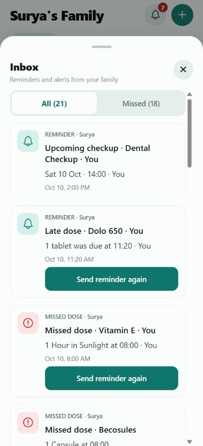

### Inbox — Missed

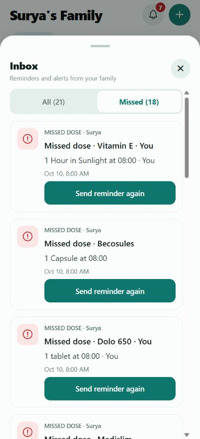

### Global add menu

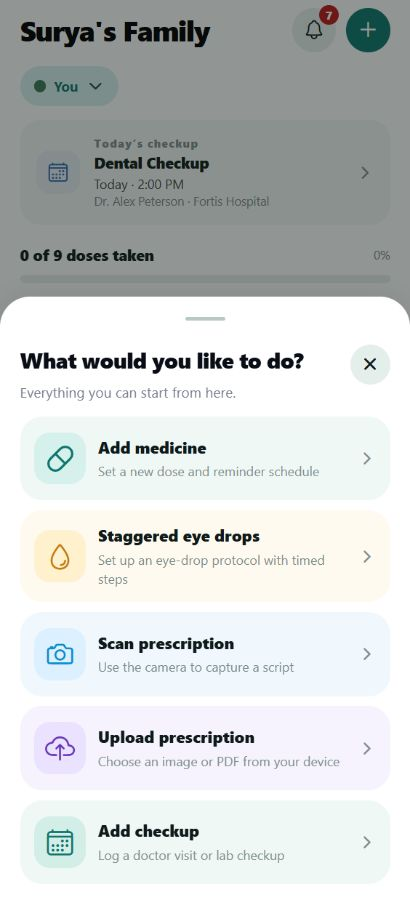

### Add medicine

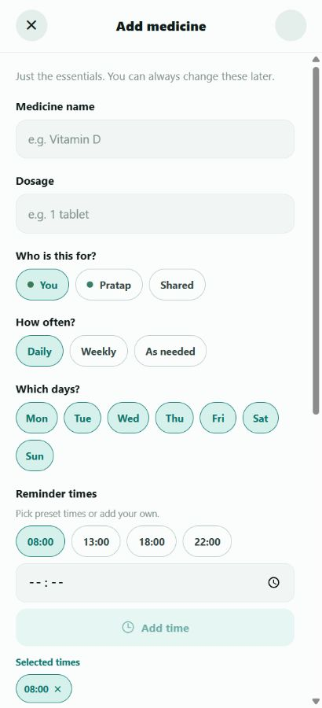

### Additional medicine fields

Stock quantity, identification cue, photo, instructions and the optional attached voice-note control appear below the schedule fields.

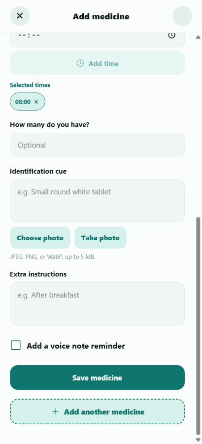

## Care and medicine schedules

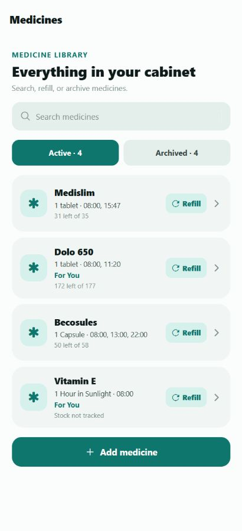

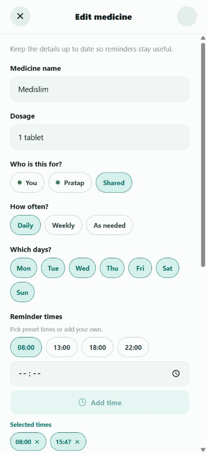

### Staggered eye-drop protocol editor

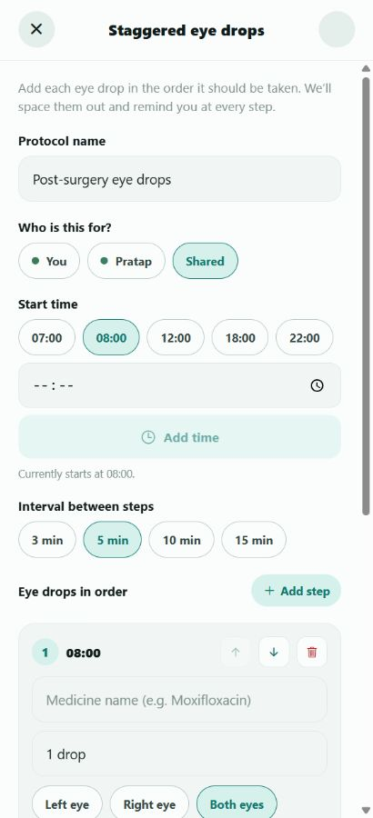

## Checkups

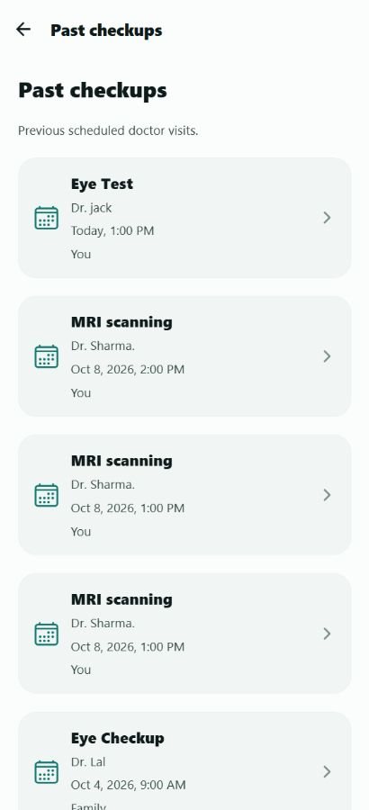

## Prescriptions

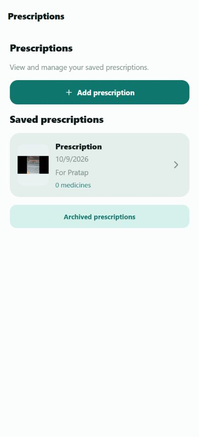

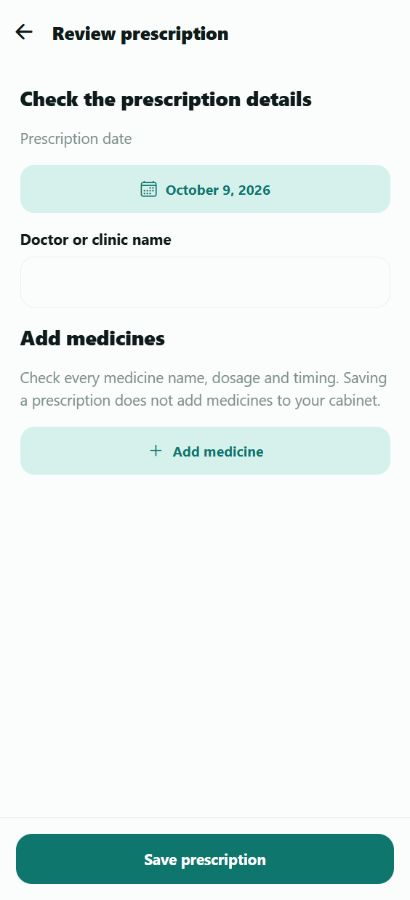

The thumbnail is shown at list size only. Automatic text/medicine extraction is not implemented.

## Family management

## History

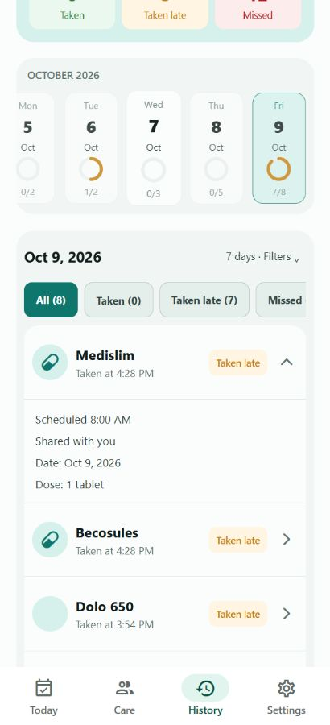

## Settings, Profile and sign-in entry

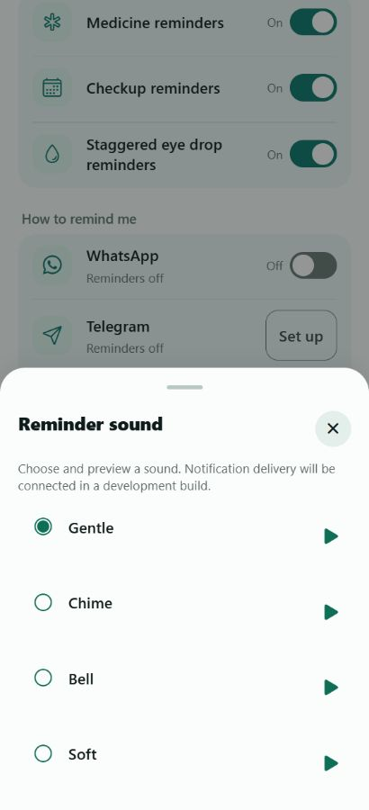

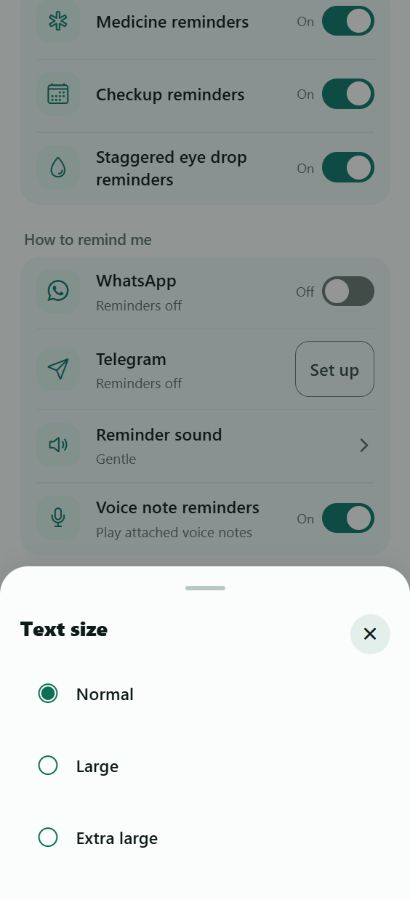

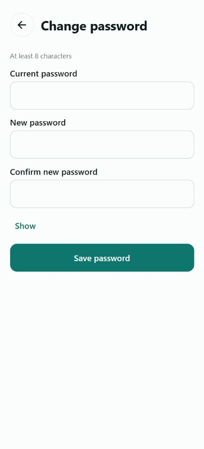

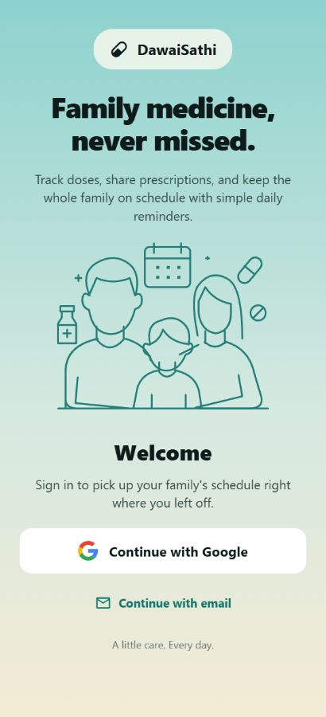

Settings extends below the first viewport; the main guide describes Comfort and Log out as well. No preferences or credentials were changed to create these captures.
